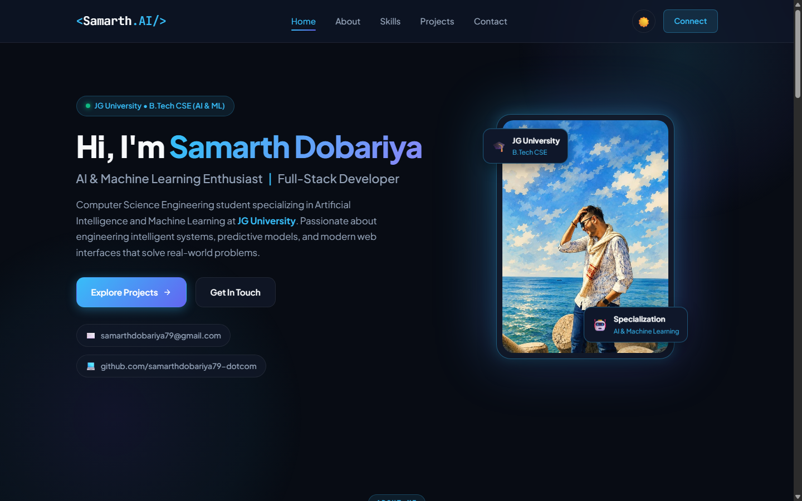

# Samarth Dobariya — Personal Portfolio

A modern, responsive personal portfolio website for **Samarth Dobariya**, B.Tech Computer Science & Engineering (Artificial Intelligence & Machine Learning) student at JG University. It showcases academic background, technical skills, featured AI/ML and web projects, and an interactive contact form with client-side validation.

## Live Demo

- **GitHub Pages:** https://samarthdobariya79-dotcom.github.io/samarth_dobariya_268411/

## Screenshot

## Technologies Used

- **HTML5** — Semantic structure and accessible markup
- **CSS3** — Custom properties (CSS variables), Flexbox, Grid, glassmorphism, animations, and responsive media queries
- **JavaScript (ES6+)** — Dark/light theme toggle (`localStorage` persistence), responsive mobile hamburger menu, scrollspy active navigation highlighting, and contact form validation
- **Google Fonts** — `Plus Jakarta Sans` and `JetBrains Mono`

## Features

- Dark-first design with instant Dark/Light mode switching
- Sticky glassmorphic navbar with scrollspy and mobile drawer menu
- Hero showcase with profile card and quick contact links
- About Me, Technical Skills progress bars, and Featured Projects cards
- Interactive Contact Form with real-time validation and status feedback
